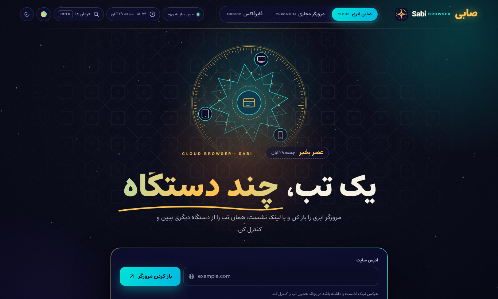
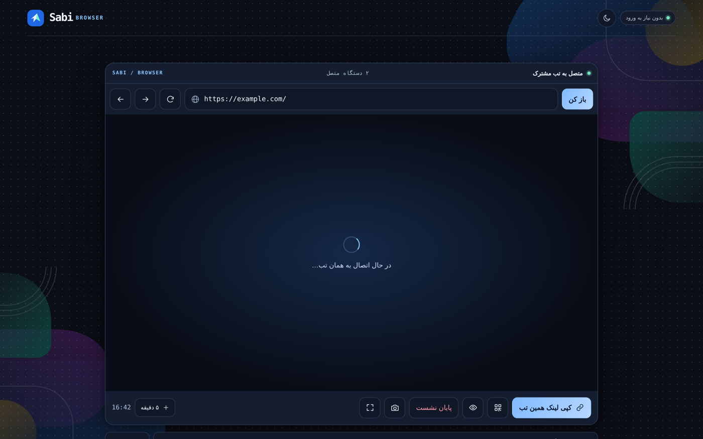
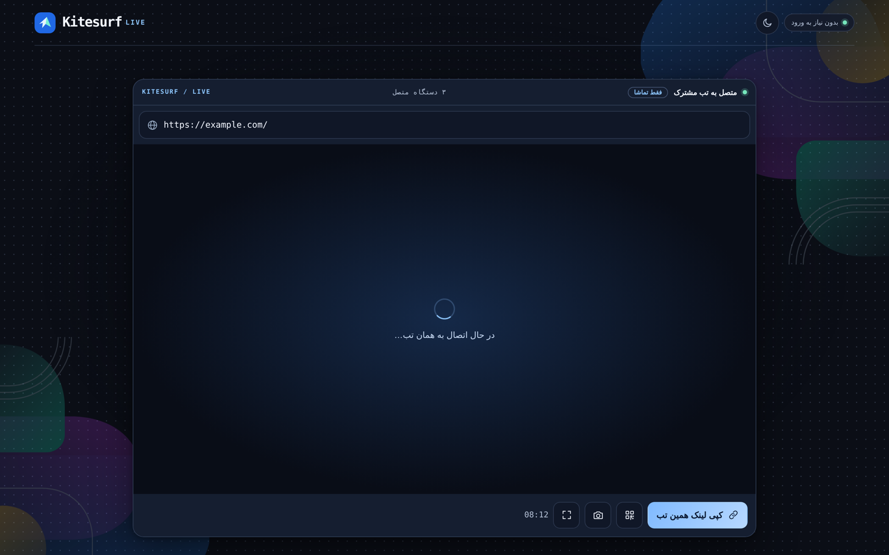
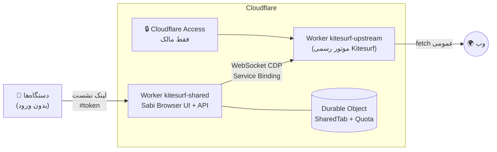

<div dir="rtl" align="center">



# ☁️ Sabi Browser

**یک تب، چند دستگاه — مرورگر ابری بدون ایمیل، بدون رمز، بدون ورود**

[](https://workers.cloudflare.com)
[](https://developers.cloudflare.com/durable-objects/)
[](https://github.com/cloudflare/kitesurf)
[](LICENSE)

[**🌐 نسخهٔ زنده**](https://sabi-browser.nikanesalamat.ir) · [راهنمای بازسازی](docs/REBUILD.md) · [تاریخچهٔ استقرار](docs/DEPLOYMENT-HISTORY.md)

</div>

<div dir="rtl">

## این چیست؟

سابی یک **مرورگر ابری اشتراکی** است: آدرس یک سایت را می‌دهی، یک تب واقعی روی لبهٔ Cloudflare باز می‌شود و یک **لینک نشست** می‌گیری. آن لینک را روی هر دستگاه دیگری باز کنی، **همان تب** را زنده می‌بینی و کنترل می‌کنی — کلیک، تایپ، اسکرول. نه حساب کاربری، نه ایمیل، نه رمز.

موتور رندر، [Cloudflare Kitesurf](https://github.com/cloudflare/kitesurf) رسمی و دست‌نخورده است که خصوصی و پشت Cloudflare Access نگه داشته شده؛ سابی فقط یک لایهٔ اشتراک امن روی آن است.

## ✨ امکانات

| | قابلیت | توضیح |
|---|---|---|
| 🔗 | **لینک نشست** | توکن ۶۴ رقمی در fragment آدرس (`#…`) — هرگز به سرور لاگ نمی‌شود |
| 👁 | **لینک فقط تماشا** | لینک جدا (`#v…`) که فقط تصویر می‌دهد؛ از نظر ریاضی به لینک کنترل برنمی‌گردد |
| 📱 | **QR کد** | ساخت QR کاملاً سمت کلاینت؛ دو تب «کنترل» و «فقط تماشا» |
| 🤝 | **اشتراک‌گذاری سیستمی** | `navigator.share` روی موبایل |
| ⏱ | **تمدید نشست** | ۱۲ دقیقهٔ پایه + تمدیدهای ۵ دقیقه‌ای تا سقف ۳۰ دقیقه |
| 👥 | **شمارندهٔ دستگاه‌ها** | «۲ دستگاه متصل» بر پایهٔ شناسه‌های ناشناس ۱۵ ثانیهٔ اخیر |
| 🖐 | **اسکرول لمسی** | کشیدن انگشت = اسکرول، ضربه = کلیک؛ رفتار ماوس دسکتاپ جداست |
| 🌗 | **تم** | خودکار / روشن / تیره، ذخیره در localStorage |
| 📸 | **عکس صفحه** | دانلود فریم فعلی به JPEG |
| ⛶ | **تمام‌صفحه** | روی نمای تب |
| 🇮🇷 | **فارسی و RTL کامل** | طراحی اختصاصی، بدون فریم‌ورک، یک فایل HTML |

<div align="center">

<br><sub>میزکار کنترل</sub>
<br><br>

<br><sub>حالت فقط تماشا — همهٔ ابزارهای کنترل حذف شده‌اند</sub>
</div>

## 🏗 معماری



- **موتور خصوصی می‌ماند.** README خود Kitesurf هشدار می‌دهد که موتور بدون احراز هویت را عمومی نکنید؛ اینجا فقط از راه Service Binding داخلی مصرف می‌شود و مسیرهای خام CDP/DevTools روی دامنهٔ عمومی ۴۰۴ هستند.
- **هر نشست یک Durable Object** با یک اتصال CDP است؛ همهٔ بیننده‌ها همان یک تب را می‌بینند (نشست‌های CDP کایت‌سرف بین اتصال‌ها مشترک نیستند — این لایه مشترکشان می‌کند).
- **توکن‌ها**: نام DO برابر `sha256('session|' + sha256('view|' + token))` است؛ سرور فقط هش می‌بیند. نقش تماشا (`x-kitesurf-role: view`) فقط به `/api/frame` می‌رسد.
- **سهمیه‌ها**: حداکثر ۳ نشست همزمان، ۲۰ شروع در ساعت، ۵ شروع در ساعت به ازای هر IP (هش‌شده)؛ آدرس‌های خصوصی/داخلی/عددی رد می‌شوند.

## 🧩 API

| Endpoint | Method | Auth | کار |
|---|---|---|---|
| `/api/start` | POST (same-origin) | — | ساخت نشست؛ برمی‌گرداند `{token, view, expires}` |
| `/api/frame` | GET | Bearer | آخرین فریم JPEG + هدرهای `x-kitesurf-*` |
| `/api/action` | POST (same-origin) | Bearer (کنترل) | `go / reload / back / forward / click / pointer / wheel / text / key` |
| `/api/extend` | POST (same-origin) | Bearer (کنترل) | +۵ دقیقه تا سقف ۳۰ دقیقه |
| `/api/close` | POST (same-origin) | Bearer (کنترل) | پایان نشست برای همه |

## 🚀 استقرار

راهنمای کامل و گام‌به‌گام در [docs/REBUILD.md](docs/REBUILD.md) — از صفر تا دقیقاً همین استقرار، با همهٔ تنظیمات، ثابت‌ها و چک‌لیست راستی‌آزمایی.

```bash
cd app
export CLOUDFLARE_API_TOKEN=... CF_ACCOUNT_ID=...
python3 deploy.py --first-time   # بار اول (migration ماژول DO)
python3 smoke.py https://your-domain.example  # آزمون زنده
```

</div>

---

<div dir="ltr">

## English summary

**Sabi Browser** is a passwordless shared cloud browser: enter a URL, get a real browser tab rendered by the official, unmodified [Cloudflare Kitesurf](https://github.com/cloudflare/kitesurf) engine on Workers, and share a capability link so any device can **see and control the same tab** — no accounts, no logins.

- `app/` — the public worker (`kitesurf-shared`): single-file RTL Persian UI + constrained frame/action API, one Durable Object per session holding a single CDP WebSocket to the engine over a Service Binding.
- `engine/` — config to run upstream Kitesurf privately behind Cloudflare Access (`wrangler.jsonc`, Access JWT wrapper, pinned image digests in `IMAGE.json`/`SOURCE.md`).
- Security: engine never exposed; capability tokens hashed server-side; separate one-way-derived **view-only** tokens; same-origin checks; per-IP and global quotas; 12-min sessions extendable to 30.
- Rebuild everything from scratch with [docs/REBUILD.md](docs/REBUILD.md).

Built with the official engine — credits to Cloudflare. UI font-free, framework-free, a single HTML file. QR codes generated fully client-side ([qrcode-generator](https://github.com/kazuhikoarase/qrcode-generator), MIT).

</div>
